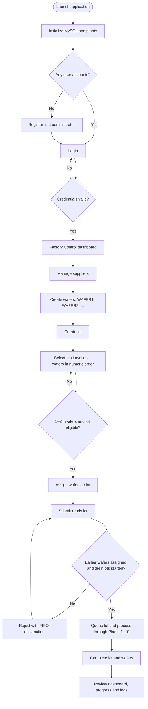
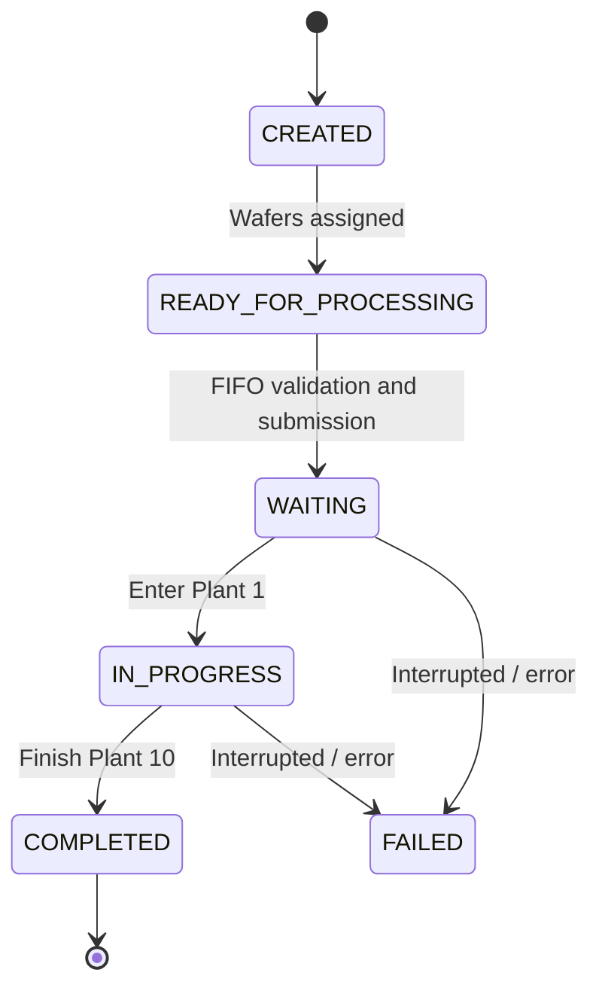
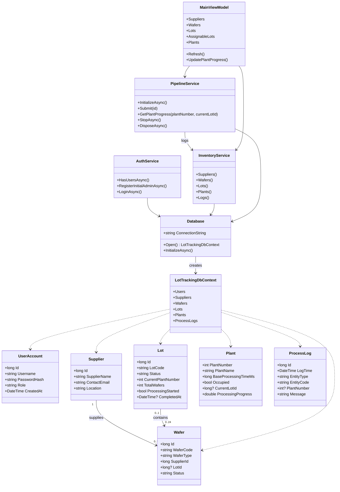
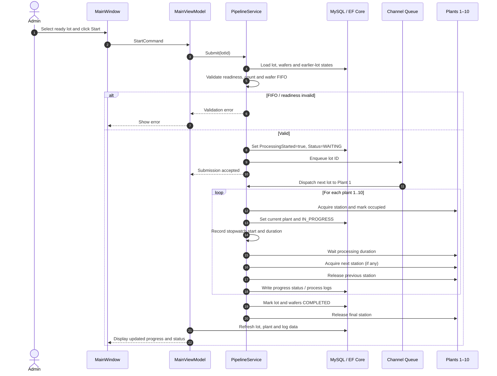
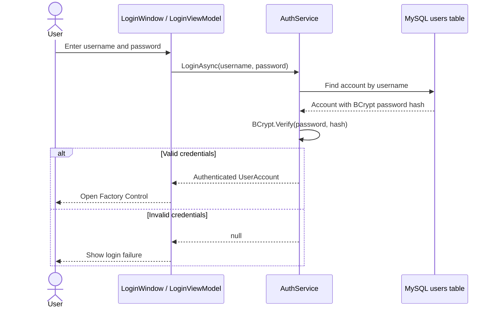
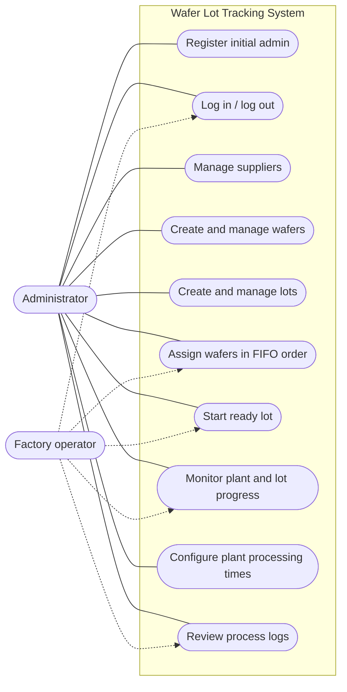

# Wafer Lot Tracking — Factory Control

A Windows desktop application for managing semiconductor wafer inventory, assigning wafers to manufacturing lots, and tracking lots as they travel through a **10-plant processing pipeline**. Built with **C#**, **.NET 8**, **WPF**, **Entity Framework Core**, and **MySQL**.

> **Scope:** This README describes the application's current design, including the later wafer-FIFO, lot-assignment, and plant-progress enhancements. Some of these enhancements are newer than the original starter project archive.

## Features

- **Authentication:** First-run administrator registration, login/logout, BCrypt password hashes stored in MySQL.
- **Supplier management:** Create, view, update, and delete suppliers.
- **Wafer inventory:** Individual and bulk wafer creation, including sequential codes such as `WAFER1`, `WAFER2`, etc.; update and delete where allowed.
- **Lot management:** Create and manage lots, with **1–24 wafers** per processable lot.
- **FIFO wafer handling:** Assign available wafers in ascending wafer-number order. A later-wafer lot cannot start until lots containing earlier-numbered wafers have started; unassigned earlier wafers block submission. This is **wafer-order enforcement**, not a requirement to process lots by lot number.
- **Processing pipeline:** Ten sequential plants, one lot per plant, with asynchronous scheduling, station locking, and persistent statuses.
- **Monitoring:** Plant occupancy, current lot, configurable plant times, lot progress, and per-plant progress indicators.
- **Auditability:** Timestamped processing logs and dashboard totals.

## Technology stack

| Layer | Technology |
| --- | --- |
| UI | WPF, XAML, C# |
| Runtime | .NET 8 (`net8.0-windows`) |
| UI architecture | MVVM, `CommunityToolkit.Mvvm` |
| Persistence | Entity Framework Core 8, Pomelo MySQL provider |
| Database | MySQL |
| Password security | BCrypt.Net-Next |
| Background coordination | `Channel<long>`, `SemaphoreSlim`, async tasks |
| Development | Visual Studio 2022 on Windows |

## Solution structure

```text
LotTrackingWpf/
├── App.xaml / App.xaml.cs          # Startup, database initialization, login flow
├── LoginWindow.xaml(.cs)          # Registration / login UI
├── MainWindow.xaml(.cs)           # Factory tabs, UI timers and event handlers
├── appsettings.json               # Database connection configuration
├── Data/
│   ├── Database.cs                # Connection setup and database initialization
│   └── LotTrackingDbContext.cs     # EF Core mappings
├── Models/
│   ├── Records.cs                 # Supplier, Wafer, Lot, Plant, ProcessLog
│   └── UserAccount.cs             # Login account
├── Services/
│   ├── AuthService.cs             # Registration and password verification
│   ├── InventoryService.cs        # Inventory CRUD and wafer assignment
│   └── PipelineService.cs         # FIFO checks and ten-plant pipeline
├── ViewModels/
│   ├── LoginViewModel.cs
│   └── MainViewModel.cs
├── Converters/
│   ├── FifoWaferSelectionConverter.cs
│   └── PlantProgressConverter.cs
└── Infrastructure/
    └── AsyncCommand.cs
```

## Getting started

1. Install **Visual Studio 2022** with the **.NET desktop development** workload, the **.NET 8 SDK**, and a reachable **MySQL** server.
2. Open `LotTrackingWpf.sln` in Visual Studio.
3. Restore NuGet packages (normally automatic). The project references `BCrypt.Net-Next`, `CommunityToolkit.Mvvm`, EF Core and `Pomelo.EntityFrameworkCore.MySql`.
4. Configure the `ConnectionString` value in `appsettings.json` to point to your MySQL instance. Use a dedicated database account with only the permissions the app needs.
5. Build and run. On a fresh database, initialization creates the database/schema and seeds **Plants 1–10**. Register the first administrator, then log in.
6. Add a supplier, create wafers, create a lot, assign wafers in FIFO order, and submit the ready lot for processing.

**Configuration example** (replace placeholders with your own values; do not commit real credentials):

```json
{
  "ConnectionString": "Server=localhost;Port=3306;Database=lot_tracking_wpf;User=YOUR_DB_USER;Password=YOUR_DB_PASSWORD;"
}
```

> **Schema note:** EF Core `EnsureCreatedAsync()` is appropriate for initial creation but does not perform incremental schema migrations. If a later version adds a table (for example, `wafer_sequences`), an existing database needs a corresponding schema update. Back up data before changing schema.

## Application workflow



## Manufacturing pipeline

The pipeline moves a lot **Plant 1 → Plant 2 → ... → Plant 10**. A plant is protected by a semaphore so it cannot process two lots simultaneously. The lot waits for the next plant before releasing the previous plant, preserving occupancy coordination.


**Processing time for a plant:**

```text
Duration (ms) = Plant.BaseProcessingTimeMs × Lot.TotalWafers
```

The lower **Lot Processing Progress** display shows coarse milestones (`0%, 25%, 50%, 75%, 100%`). The per-plant progress display uses a stopwatch for the active operation, shows those same milestones, and resets to `0%` after the lot leaves the plant. The UI can update progress at 100 ms intervals independently of the two-second database refresh. Progress timing is transient and is **not persisted** to MySQL.

### Lot state flow



Once a lot has started processing, it cannot receive additional wafers. Completed and processing lots are excluded from the **Assign Wafers** dropdown. A completed lot cannot be started again.

## Class diagram

This diagram highlights the main entities and application services. Associations reflect the database relationships and service dependencies; method names are representative.



`Plant.ProcessingProgress` and the display-only supplier/lot names are not stored as regular database columns; they are populated for the UI.

## Sequence diagram — submit and process a lot



## Sequence diagram — login



## Use case diagram

Mermaid does not provide a dedicated UML use-case syntax in all renderers, so the diagram below represents actors and use cases as a Mermaid flowchart.



**Role clarification:** The current application supports an administrator account and displays its role. The “Factory operator” actor illustrates a possible operational responsibility; it does **not** imply a separately implemented, enforced operator role or permissions system.

## Data model overview

| Entity/table | Purpose | Key fields |
| --- | --- | --- |
| `users` | Application accounts | `username`, `password_hash`, `role` |
| `suppliers` | Wafer sources | `supplier_name`, contact details |
| `wafers` | Individual wafer inventory | `wafer_code`, `supplier_id`, `lot_id`, `status` |
| `lots` | Groups of wafers | `lot_code`, `status`, `total_wafers`, `processing_started` |
| `plants` | Ten processing stations | `plant_number`, `base_processing_time_ms`, `occupied`, `current_lot_id` |
| `process_logs` | Processing event history | `log_time`, `entity_code`, `plant_number`, `message` |
| `wafer_sequences` | Persistent wafer numbering coordination | `sequence_name`, `next_value` |

The `wafer_sequences` table is used by the newer wafer numbering / submission logic. Ensure it exists in databases created with older versions of the application.

## FIFO rules: important examples

Suppose wafers `WAFER1`–`WAFER8` belong to `LOT2`, while `WAFER9`–`WAFER12` belong to `LOT1`.

| Action | Expected behavior |
| --- | --- |
| Start `LOT1` before `LOT2` | **Rejected:** earlier wafers belong to a lot that has not started. |
| Start `LOT2` first | **Accepted** if otherwise ready. |
| Start `LOT1` after `LOT2` has started | **Accepted** if otherwise ready. |
| Try to assign wafers to completed `LOT2` | **Rejected:** processed lots are not assignable. |
| Try to restart completed `LOT2` | **Rejected:** already processed. |

**Concurrency nuance:** The implemented FIFO check enforces *lot start order based on wafer numbers*. Once an earlier-wafer lot has started, a later-wafer lot may also start and occupy another plant concurrently. It does **not** guarantee that every individual wafer finishes all ten plants before the next wafer begins.

## UI tabs

| Tab | Responsibility |
| --- | --- |
| Dashboard | Totals for suppliers, wafers, lots, active/completed/failed lots and occupied plants |
| Suppliers | Supplier CRUD |
| Wafers | Single and bulk wafer creation, editing and deletion |
| Lots | Lot creation, editing, deletion and processing state |
| Assign Wafers | Eligible lot dropdown, FIFO wafer selection, max 24 per lot |
| Plant Monitor | Plant occupancy, timing, active lot, plant progress and lot progress |
| Processing | Select and submit ready lots |
| Logs | Review processing events |

## Operational notes and limitations

- **Windows only:** WPF requires Windows; this is not a browser or cross-platform desktop application.
- **Single-instance assumption:** The current in-memory station semaphores and queue coordinate work inside one running application process. They are not a distributed multi-instance scheduler.
- **Recovery:** Pipeline initialization includes logic for interrupted work. Review failure states and logs after unexpected shutdowns before restarting production runs.
- **Progress sampling:** Short plant operations may complete before every 25% milestone is visible. Use a longer processing time when demonstrating the UI.
- **Password storage:** The application stores a BCrypt hash, not the original plaintext password. Protect the MySQL connection string and do not commit secrets.
- **Testing:** Automated integration, load, and concurrency tests are recommended before using the software for real manufacturing operations.

## Suggested manual test checklist

- [ ] Register the first administrator and verify login works.
- [ ] Confirm `users.password_hash` contains a BCrypt hash, not the password.
- [ ] Add a supplier and bulk-create wafers with sequential codes.
- [ ] Assign wafers to a lot in numeric order; verify out-of-order selection is blocked.
- [ ] Try starting a later-wafer lot before the earlier-wafer lot; verify FIFO rejection.
- [ ] Start the earlier-wafer lot, then the later-wafer lot.
- [ ] Verify only one lot occupies any plant at a time.
- [ ] Verify plant progress advances and resets after a lot leaves.
- [ ] Verify a lot and its wafers become `COMPLETED` after Plant 10.
- [ ] Verify completed lots disappear from the assignment dropdown.
- [ ] Verify completed lots cannot be processed again.
- [ ] Review process logs and dashboard counts.

---

**Project:** Wafer Lot Tracking — Factory Control  
**Primary language:** C#  
**Application type:** WPF desktop application  
**Database:** MySQL
